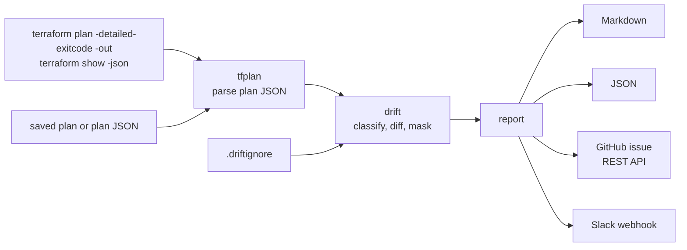

# driftwatch

> Personal learning project, built pairing with Claude Code. Every company, person and number here is made up.

Terraform drift detection that reads the plan the way Terraform writes it.
driftwatch runs (or reads) `terraform plan -detailed-exitcode -out` and
`terraform show -json`, classifies every change as delete, replace, update or
create, masks sensitive values, applies your ignore rules, and reports the
result as Markdown, JSON, a GitHub issue and a Slack message. A composite
GitHub Action runs it on a schedule.

## What has and has not been run for real

- **No real cloud account.** Drift detection reads `terraform plan` /
  `terraform show -json` output. It has only been run against a small local
  workspace (`testdata/workspaces`) that uses the `null`, `random` and `local`
  providers and `terraform_data`; it has never planned AWS, Azure or GCP
  resources. The plans in `testdata/plans` are real Terraform 1.17.1 output from
  that workspace, apart from `deferred.json`, which is written by hand.
- **GitHub issues and Slack: local fakes only.** Both clients are tested
  against `httptest` servers in the test suite. driftwatch has not opened an
  issue in a real repository or posted to a real Slack workspace.
- **GitHub Action: this repository's CI only.** The `action` job in
  [ci.yml](.github/workflows/ci.yml) runs it against a recorded plan with issue
  creation off. The scheduled workflow in
  [examples/workflows](examples/workflows/drift-check.yml) has not been run.
- **Container image: CI only.** The development machine has no Docker daemon,
  so the image is built and smoke-tested only in CI.
- **What was run locally:** `go test ./...` (80 test functions, 297 passing
  results with subtests; the end-to-end test skips unless enabled), the
  end-to-end test with `DRIFTWATCH_E2E=1` against Terraform 1.17.1, and the
  quickstart below, whose output matches
  [examples/sample-report.md](examples/sample-report.md) apart from the
  timestamp.

## The problem

Infrastructure drifts. Someone resizes an instance in the console during an
incident, a script deletes a file Terraform manages, a module upgrade quietly
changes a default. Nobody notices until the next `terraform apply` wants to
replace a database.

Running `terraform plan` on a cron job is the usual first answer, and it falls
short quickly:

- The exit code says "something changed" and nothing else.
- The human-readable plan is long, changes between releases, and is awkward to
  parse or to post anywhere.
- Some differences are expected (tags managed by another tool, timestamps) and
  turn the job into noise people learn to ignore.
- Nobody owns the result: the log scrolls away in a workflow run.

driftwatch keeps the cron job but turns its output into something a team can
act on: one GitHub issue per workspace that is updated while the drift lasts
and closed when it is gone, a short Slack summary, and a machine-readable
report for anything else.

## Architecture



The binary is plain Go with no third-party modules. Each stage is a package
under `internal/`; [docs/ARCHITECTURE.md](docs/ARCHITECTURE.md) covers them in
detail, and [ADR 0001](docs/adr/0001-read-plan-json-instead-of-parsing-cli-output.md)
explains why driftwatch reads the JSON plan.

## Quickstart

Requirements: Go 1.24 or newer. Terraform is only needed to plan live
workspaces; the quickstart uses a recorded plan.

```sh
git clone https://github.com/builtbyshailendra/driftwatch.git
cd driftwatch
go build -o bin/ ./cmd/driftwatch
./bin/driftwatch check \
  --plan-json testdata/plans/drift.json \
  --workspace payments-prod \
  --ignore-file examples/driftignore \
  --exit-code
echo "exit code: $?"
```

`testdata/plans/drift.json` is real `terraform show -json` output from
Terraform 1.17.1, produced by [scripts/gen-fixtures.sh](scripts/gen-fixtures.sh)
against the workspace in `testdata/workspaces/drift`. `./bin/driftwatch version`
prints the release tag when built from a tagged commit (no release is tagged
yet) and `dev+<commit>` otherwise. The full Markdown output
of this command is in [examples/sample-report.md](examples/sample-report.md)
and the JSON in [examples/sample-report.json](examples/sample-report.json).

To check a live workspace instead, point `--dir` at an initialised Terraform
directory:

```sh
cd testdata/workspaces/drift
terraform init && terraform apply -auto-approve
rm out/inventory.json                       # drift outside Terraform
../../../bin/driftwatch check --dir . --plan-arg=-var=owner=data-platform --exit-code
```

## Usage

### Output

stderr carries a one-line summary; stdout carries the report:

```text
$ ./bin/driftwatch check --plan-json testdata/plans/drift.json --workspace payments-prod --ignore-file examples/driftignore --exit-code
driftwatch: payments-prod: 1 to delete, 5 to replace, 1 to create, 1 changed outside Terraform
exit code: 2
```

Excerpts from the Markdown report on stdout, with `...` marking omitted
sections (the full report is [examples/sample-report.md](examples/sample-report.md)):

```markdown
# Terraform drift report: payments-prod

**Drift detected: 1 to delete, 5 to replace, 1 to create, 1 changed outside Terraform.**

Generated 2026-11-08 08:35 UTC with Terraform 1.17.1.

| Change | Count |
|---|---:|
| Delete | 1 |
| Replace | 5 |
| Update in place | 0 |
| Create | 1 |
| Changed outside Terraform | 1 |
| Ignored by rules | 3 |

## Changed outside Terraform

Terraform found these objects changed since the last apply, without going through Terraform.

### `local_file.inventory` delete

Severity **high**, provider `hashicorp/local`.

## Planned changes

Applying the current configuration would make these changes.

### `null_resource.cache_warmer[0]` delete

Severity **high**, provider `hashicorp/null`, because count no longer includes this index.

...

### `random_password.database` replace

Severity **high**, provider `hashicorp/random`, because an attribute that forces replacement changed.

| Attribute | Before | After | Note |
|---|---|---|---|
| `bcrypt_hash` | _(sensitive value)_ | _(sensitive value)_ | sensitive |
| `id` | `"none"` | _(known after apply)_ |  |
| `keepers.rotation` | `"2026-q4"` | `"2027-q1"` | forces replacement |
| `result` | _(sensitive value)_ | _(sensitive value)_ | sensitive |

...
```

The plan JSON for `random_password.database` contains the plaintext password;
the report shows `(sensitive value)` because the plan marks `result` in
`before_sensitive`. When only part of a value is sensitive, the visible part
stays readable and the secret is replaced in place:

```markdown
| `triggers_replace` | `{"password":"(sensitive value)","user":"admin"}` | _(sensitive value)_ | forces replacement, sensitive |
```

That row comes from `testdata/plans/sensitive.json`, a real plan in which an
object with one sensitive key becomes unknown until apply. Tests search the
output of every committed plan fixture for each value the plan marks
sensitive.

The JSON report (`--format json` or `--json-out`) has a stable shape,
`schema_version: 1`:

```json
{
  "schema_version": 1,
  "workspace": "payments-prod",
  "terraform_version": "1.17.1",
  "has_drift": true,
  "summary": { "delete": 0, "replace": 0, "update": 1, "create": 0, "outside": 0, "ignored": 0, "total": 1, "deferred": 0 },
  "changes": [
    {
      "address": "terraform_data.metadata",
      "kind": "update",
      "severity": "medium",
      "source": "plan",
      "attributes": [
        { "path": "input.owner", "before": "platform-team", "after": "data-platform" },
        { "path": "output", "before": { "cost_center": "cc-4410", "owner": "platform-team", "tier": "gold" }, "after": null, "after_unknown": true }
      ]
    }
  ],
  "outside_changes": [],
  "ignored": []
}
```

(Abbreviated from `driftwatch check --plan-json testdata/plans/update-only.json --workspace payments-prod --format json`.)
`summary.total` counts distinct resources, so a resource deleted by hand that
the plan recreates counts once. Incomplete plans add `plan_incomplete: true`
and `deferred_changes`, and `unused_ignore_rules` lists rules that matched
nothing.

### Plan sources

| Mode | Command | What runs |
|---|---|---|
| Live | `driftwatch check --dir infra/prod` | `terraform plan -input=false -no-color -detailed-exitcode -out=<tmp>` then `terraform show -json <tmp>`; the temporary plan is deleted |
| Saved plan | `driftwatch check --plan-file prod.tfplan` | `terraform show -json prod.tfplan` |
| JSON | `driftwatch check --plan-json plan.json` or `--plan-json -` | nothing; reads the file or stdin |

### Ignore rules

`.driftignore` in `--dir` is picked up automatically, or pass `--ignore-file`.
One rule per line, `#` starts a comment:

```text
# Ignore a whole resource, or every resource matching a glob
module.service["worker"].*

# Ignore one attribute (and everything nested under it)
terraform_data.metadata  input.owner
aws_instance.*           tags["LastScannedAt"]
aws_instance.*           tags["kubernetes.io/role"]
```

`*` matches any run of characters and `?` exactly one. Map keys can be written
either way Terraform accepts: `tags["LastScannedAt"]` and `tags.LastScannedAt`
are the same rule, even though reports print the dotted form. Keys that are not
identifiers, like `kubernetes.io/role`, need brackets, and `tags["*"]` matches
any single key. When every attribute with a known new value is ignored, the
whole change is dropped. Dropped changes still appear under "Ignored by rules"
with the rule that matched. A rule that matches nothing in the plan is noted on
stderr and listed in the JSON report, which catches typos early.

### Incomplete plans

Terraform 1.10 and later can defer part of a plan, for example when `count`
depends on a value known only after apply. driftwatch reads `complete` and
`deferred_changes`, adds a warning and a "Deferred changes" table to the
report, appends `(plan incomplete, N deferred)` to the headline and Slack
message, and prints a warning on stderr. The exit code still reflects only the
drift that was planned.

### GitHub issues

```sh
export GITHUB_TOKEN=...            # needs issues: write
driftwatch check --dir infra/prod --workspace prod --github-issue --github-repo acme/infra
```

driftwatch keeps one open issue per workspace, identified by a hidden
`<!-- driftwatch:workspace=prod -->` marker and the first label. Drift creates
the issue or replaces its body; a clean run comments and closes it.

### Slack

```sh
export SLACK_WEBHOOK_URL=https://hooks.slack.com/services/...
driftwatch check --dir infra/prod --slack
```

Posts a header, the headline counts, up to ten changed resources and a link to
the GitHub issue when one was synced. Clean runs stay quiet unless
`--slack-on-clean` is set. The webhook URL is never written to logs or errors.

### GitHub Action

```yaml
- uses: hashicorp/setup-terraform@v3
  with:
    terraform_version: 1.17.1
    terraform_wrapper: false
- run: terraform init -input=false
  working-directory: live/prod
- uses: builtbyshailendra/driftwatch/action@main   # no release tag yet
  with:
    working-directory: live/prod
    workspace: prod
    slack-webhook-url: ${{ secrets.SLACK_DRIFT_WEBHOOK }}
```

The action builds driftwatch from source, writes the Markdown report to the
job summary, and exposes `has-drift`, `report-markdown` and `report-json`
outputs. A complete scheduled workflow with a workspace matrix is in
[examples/workflows/drift-check.yml](examples/workflows/drift-check.yml).

### Container image

The [Dockerfile](Dockerfile) builds a static binary and copies it, together
with the Terraform 1.17.1 binary, into `gcr.io/distroless/static-debian12:nonroot`.
Images are built and smoke-tested in CI (`make docker` locally); the
development machine for this repository has no running Docker daemon.

```sh
docker build -t driftwatch:local .
docker run --rm -v "$PWD/live/prod:/workspace" driftwatch:local check --dir /workspace
```

## Configuration

| Flag | Environment | Default | Description |
|---|---|---|---|
| `--dir` | | `.` | Terraform working directory, already initialised |
| `--plan-file` | | | Saved plan to convert with `terraform show -json` |
| `--plan-json` | | | Plan JSON file, or `-` for stdin |
| `--plan-arg` | | | Extra `terraform plan` argument, repeatable |
| `--terraform` | `TERRAFORM` | `terraform` | Terraform binary |
| `--workspace` | | base name of `--dir` | Name in reports and the issue marker |
| `--ignore-file` | | `<dir>/.driftignore` if present | Ignore rules |
| `--format` | | `markdown` | Report on stdout: `markdown`, `json` or `none` |
| `--markdown-out` | | | Also write the Markdown report here |
| `--json-out` | | | Also write the JSON report here |
| `--exit-code` | | `false` | Exit 2 when drift is found |
| `--github-issue` | `GITHUB_TOKEN` | `false` | Sync the workspace issue |
| `--github-repo` | `GITHUB_REPOSITORY` | | `owner/name` |
| | `GITHUB_API_URL` | `https://api.github.com` | API base, for GitHub Enterprise Server |
| `--github-labels` | | `driftwatch,terraform-drift` | Issue labels; the first one is used for lookup |
| `--close-resolved` | | `true` | Close the issue when drift is gone |
| `--slack` | `SLACK_WEBHOOK_URL` | `false` | Post to Slack when drift is found |
| `--slack-on-clean` | | `false` | Also post clean results |

Secrets are read only from the environment so they do not end up in shell
history or process listings. Exit codes: `0` success, `1` error, `2` drift with
`--exit-code`.

## Testing

```sh
go test ./...                       # unit and integration tests, offline
DRIFTWATCH_E2E=1 go test ./internal/cli -run EndToEnd -v   # real terraform
go vet ./... && gofmt -l .
terraform fmt -check -recursive testdata/workspaces
```

- Parser, classifier and report tests run against the committed plan fixtures
  in `testdata/plans`. `clean`, `update-only`, `refresh-only`, `drift` and
  `sensitive` are recorded from real Terraform 1.17.1 plans. `deferred` is
  written by hand, because Terraform only emits deferred changes with
  experimental features enabled.
- Every fixture is searched for each value the plan marks sensitive, and
  table tests cover partly sensitive values that become unknown, become
  wholly sensitive or change type.
- Markdown and JSON output is pinned by golden files in `testdata/golden`;
  `go test ./internal/report -update` rewrites them after an intended change.
- GitHub and Slack clients are tested against `httptest` servers that model
  the issue search, create, update, comment and close endpoints.
- The Terraform runner is tested with a scripted executor, and the real
  `os/exec` path with the standard helper-process pattern.
- The end-to-end test copies the fixture workspace to a temp dir, runs
  `terraform init` and `apply`, deletes a managed file and checks that
  driftwatch reports both the outside change and a variable-driven update.
  CI runs it with Terraform 1.17.1.

`make fixtures` regenerates the plan JSON from scratch (needs network for the
provider downloads).

## Design decisions

- **JSON plan only.** The human plan output is not a contract; the JSON plan
  is. See [ADR 0001](docs/adr/0001-read-plan-json-instead-of-parsing-cli-output.md).
- **Masking at the source.** The diff step never copies a sensitive value
  into an `Attribute`, so renderers cannot leak what they never receive.
  Partly sensitive values are copied with the secret parts replaced, and a
  marker that does not fit its value masks the whole value: fail closed.
- **Fail loudly on unknown actions.** A new Terraform action stops the run
  instead of being skipped as "no drift".
- **Outside changes are reported separately.** `resource_drift` tells you who
  to talk to (someone changed it by hand); `resource_changes` tells you what
  apply will do.
- **Issue identity by marker, not title.** People can rename the issue,
  and several workspaces can share a repository.
- **No dependencies.** The ignore format is a two-column text file rather than
  YAML, and the HTTP clients use `net/http` directly.
- **Reports before notifications.** A Slack or GitHub failure turns the exit
  code to 1 but the reports are already on disk.

## Limitations

- driftwatch masks what Terraform marks sensitive, and also any string equal
  to a marked value or to a sensitive root variable, wherever it reappears
  unmarked (terraform_data, for example, copies `input` to `output` without
  the marks). Secrets of eight or more characters are also masked inside
  longer strings. Derived values such as the content hashes of
  `local_sensitive_file` are not secrets Terraform knows about, and appear in
  the report just as they do in `terraform plan`.
- Output value changes (`output_changes`) and `moved` blocks without other
  changes are not reported.
- `forget` actions from `removed` blocks are treated as no drift.
- Deferred changes in incomplete plans are listed with Terraform's reason but
  not diffed or counted as drift, because their values are mostly unknown.
- Planning runs with Terraform's normal state locking; a long apply holding
  the lock makes the check fail rather than wait, unless you pass
  `--plan-arg=-lock-timeout=5m`.
- Issue lookup scans at most 1,000 open issues carrying the first label.
- Only Slack incoming webhooks are supported, not the Web API.

## Roadmap

- Report `output_changes` alongside resources.
- Optional redaction rules for attributes providers do not mark sensitive.
- Microsoft Teams webhook notifier.
- Multi-workspace summary issue that links per-workspace issues.
- Publish release binaries and the container image from a tagged workflow.

## License

[MIT](LICENSE) (c) 2026 Shailendra Singh
