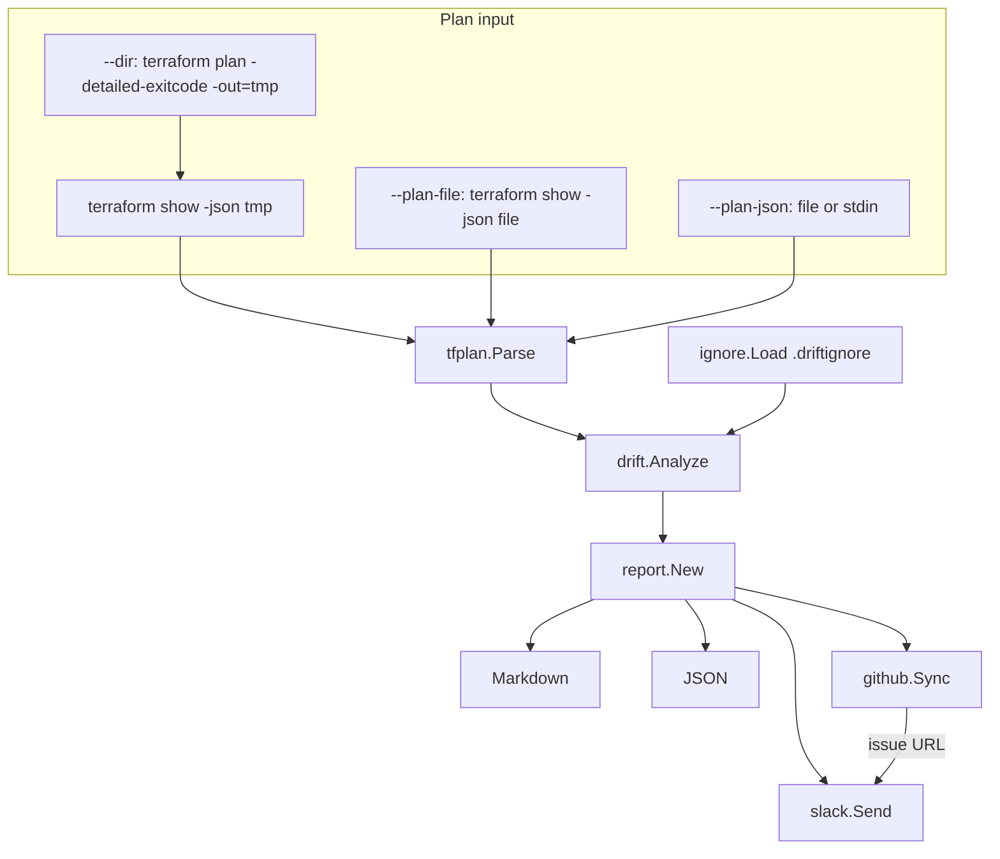

# Architecture

driftwatch is a single Go binary with no third-party dependencies. It turns one
Terraform plan into a drift report and, optionally, pushes that report to
GitHub and Slack. This document describes the moving parts and the data that
flows between them.

## Pipeline

## Packages

| Package | Responsibility |
|---|---|
| `cmd/driftwatch` | `main`: wires signals and the version string into `cli.App`. |
| `internal/cli` | Flag parsing, choosing the plan source, writing reports, notifications and exit codes. Every external dependency (stdin/stdout, environment, HTTP client, process executor, clock) is a field on `App`, so tests replace them. |
| `internal/terraform` | Runs `terraform plan -input=false -no-color -detailed-exitcode -out=<tmp>` and `terraform show -json <tmp>` through an `Executor` interface. Exit code 0 and 2 are success, anything else becomes an error carrying the last 20 lines of stderr. The temporary plan file is always removed: it contains state. |
| `internal/tfplan` | Decodes the plan JSON (format 1.x) into typed structs, including `complete` and `deferred_changes`. Provider-specific values (`before`, `after`, `after_unknown`, `before_sensitive`, `after_sensitive`) stay as `any` decoded with `UseNumber`, so large integers are not rounded. Also owns attribute paths, rendered dotted (`tags.Name`, `ingress[0].cidr_blocks[1]`) or in bracket form (`tags["Name"]`). |
| `internal/ignore` | Parses `.driftignore` and matches addresses and attribute paths with a small glob matcher. |
| `internal/drift` | Classifies actions, diffs attributes, masks sensitive values, applies ignore rules and collects deferred changes. Produces `drift.Result`. |
| `internal/report` | Wraps a result with metadata (workspace, timestamp, summary counts) and renders Markdown and JSON. |
| `internal/github` | Minimal REST client: find, create, update, comment on and close issues. `Sync` implements the issue lifecycle. |
| `internal/slack` | Builds a Block Kit message and posts it to an incoming webhook. |

## Classification

Terraform encodes each planned change as an action list. driftwatch maps them:

| Actions | Kind | Severity |
|---|---|---|
| `["delete"]` | delete | high |
| `["delete","create"]`, `["create","delete"]` | replace | high |
| `["update"]` | update | medium |
| `["create"]` | create | low |
| `["no-op"]`, `["read"]`, `["forget"]` | not drift | |

Anything else is an error rather than a silent skip, so a future Terraform
action cannot hide drift. Data sources are skipped.

Two sections of the plan are read:

- `resource_changes` are what `terraform apply` would do to bring
  infrastructure back to the configuration. Reported as "Planned changes".
- `resource_drift` are differences Terraform found while refreshing state,
  meaning someone changed or deleted the object outside Terraform. Reported
  as "Changed outside Terraform".

A resource can appear in both: an object deleted by hand shows up as an
outside delete and as the planned create that restores it. The per-kind
counts include both entries; `summary.total` counts distinct resources.

## Incomplete plans

Terraform 1.10 and later can defer changes it cannot plan yet, for example
when `count` or a provider configuration depends on a value known only after
apply. Such a plan has `"complete": false` and lists the postponed changes
under `deferred_changes`. driftwatch treats a plan as incomplete when either
is the case. The report then carries a warning, a "Deferred changes" table
and `plan_incomplete: true` in JSON, and the CLI prints a warning on stderr,
because the drift shown may be only part of the picture. Deferred changes are
listed, not classified: their values are mostly unknown.

## Attribute diff and masking

For updates and replacements, `drift.DiffAttributes` walks `before` and
`after` in step, together with the three marker trees:

- `before_sensitive` / `after_sensitive`: `true` masks the whole subtree.
  The emitted `Attribute` stores `nil` for a masked side and sets
  `before_sensitive` or `after_sensitive`. An object or array marker marks
  children individually, and the walk follows it.
- When the walk stops early (the new value is wholly unknown or wholly
  sensitive, or the value changed type, say from an object to a string) the
  value it emits can still contain marked children. `drift.Mask` copies it
  with every marked element replaced by `(sensitive value)` and sets
  `contains_sensitive`. If a marker's shape does not fit the value, Mask
  masks the whole value rather than guess. Either way the secret never enters
  the struct, so no renderer can print it.
- Terraform tracks sensitivity per value, so a secret can reappear unmarked:
  `terraform_data` copies `input` to `output` without the marks. Before
  analysis, `drift.CollectSecrets` gathers every string the plan marks
  sensitive anywhere, plus the values of root variables declared sensitive,
  and `Secrets.Scrub` masks matching strings in every emitted value (whole
  values always, substrings for secrets of eight characters or more).
- `after_unknown`: `true` means the value is computed during apply. Unknown
  attributes are absent from `after`, so keys from `after_unknown` are merged
  into the walk.
- `replace_paths`: an attribute is marked `forces_replacement` when its path
  is equal to, a parent of, or a child of a replace path.

Unchanged sensitive values are compared but never reported. Tests check every
committed plan fixture, including one recorded from a real Terraform plan
with partly sensitive objects (`testdata/plans/sensitive.json`), for any value
the plan marks sensitive.

## Ignore rules

A rule without an attribute pattern suppresses the whole resource. A rule
with one removes matching attributes, and the attribute pattern also matches
anything nested below it. When every attribute whose new value is known has
been ignored, the whole change is suppressed. Attributes that merely become
`(known after apply)` are consequences of the change, not causes, so they do
not keep an ignored change alive. Suppressed changes are still listed in the
report under "Ignored by rules", with the rules that matched, so nothing
disappears silently.

Reports render map keys dotted when they are identifiers (`tags.Name`) and in
brackets otherwise (`tags["kubernetes.io/role"]`). Terraform accepts both
spellings, so rules do too: each attribute path is matched in its dotted and
its bracket form, and a pattern's bracketed identifier keys are also tried in
dotted form. Rules that match nothing in a plan are listed in the JSON report
(`unused_ignore_rules`) and noted on stderr; that is normal for a rule whose
attribute did not change this time, and the quickest way to spot a typo.

## GitHub issue lifecycle

One issue per workspace. The issue body ends with a hidden marker,
`<!-- driftwatch:workspace=NAME -->`, and carries the first configured label.

| Drift | Open issue with marker | Action |
|---|---|---|
| yes | no | `POST /repos/{owner}/{repo}/issues` |
| yes | yes | `PATCH /repos/{owner}/{repo}/issues/{n}` with the new title and body |
| no | yes | comment, then `PATCH` with `state=closed` (unless `--close-resolved=false`) |
| no | no | nothing |

Search uses `GET /repos/{owner}/{repo}/issues?state=open&labels=<first label>`,
up to 10 pages of 100, skipping pull requests. Bodies are cut to GitHub's
65,536 character limit with the marker preserved.

## Exit codes

| Code | Meaning |
|---|---|
| 0 | Success, no drift, or drift without `--exit-code` |
| 1 | Error: bad flags, Terraform failure, unreadable plan, or a failed GitHub/Slack call |
| 2 | Drift found and `--exit-code` set |

Reports are written before notifications run, so a Slack or GitHub outage
still leaves the Markdown and JSON reports on disk.
